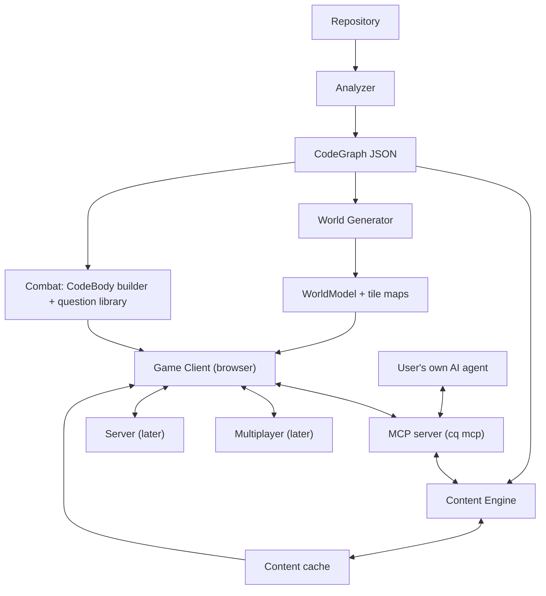
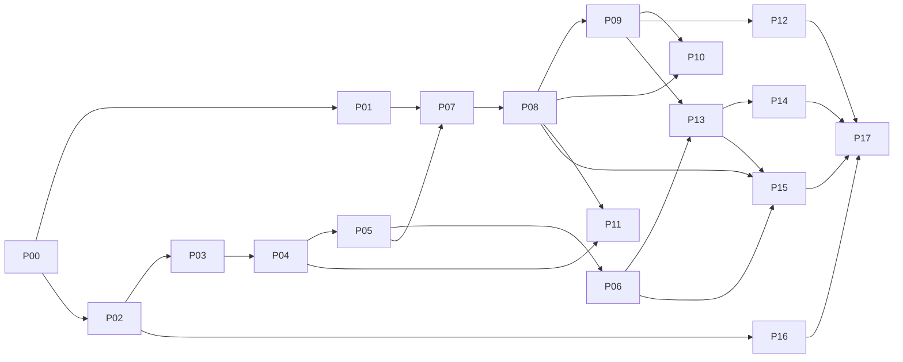

# Codebase Quest: Master Plan

> **"Every codebase is a world. Go explore."**

Codebase Quest turns any code repository into a 2D pixel-art RPG. Folders become
regions, files become buildings, and functions become characters you can talk to.
Code smells are monsters whose **bodies are made of their real code**. The most
complex code becomes a boss, and your final quest is fixing a **real** issue in the
**real** project.

It's **open source**, **free to play**, works **without an API key**, and lets your
own AI agent (Claude Code, Codex, Cursor…) power it through **MCP**, the same way
REA does.

This is the big, connected plan. The phase plans in [`phases/`](phases/) break it
into 18 steps you build and test one at a time. Start with [README.md](README.md)
for the order, status and how to hand each phase to Claude.

---

## Contents

1. [The vision](#1-the-vision)
2. [Design pillars](#2-design-pillars)
3. [Who it's for](#3-who-its-for)
4. [Use cases](#4-use-cases)
5. [How code becomes a world](#5-how-code-becomes-a-world)
6. [The core gameplay loop](#6-the-core-gameplay-loop)
7. [Code-Body Combat](#7-code-body-combat)
8. [The Bestiary: monsters](#8-the-bestiary-monsters)
9. [Bosses and dungeons](#9-bosses-and-dungeons)
10. [Items, equipment and economy](#10-items-equipment-and-economy)
11. [Progression](#11-progression)
12. [Gitling, your companion](#12-gitling-your-companion)
13. [Quests](#13-quests)
14. [Game modes](#14-game-modes)
15. [A sample playthrough](#15-a-sample-playthrough-the-kingdom-of-taskly)
16. [Technical architecture](#16-technical-architecture)
17. [Quality and testing strategy](#17-quality-and-testing-strategy)
18. [Roadmap: milestones and phases](#18-roadmap-milestones-and-phases)
19. [Business model and metrics](#19-business-model-and-metrics)
20. [Risks and mitigations](#20-risks-and-mitigations)
21. [Art and asset pipeline](#21-art-and-asset-pipeline)
22. [Open source and community](#22-open-source-and-community)
23. [Future expansions](#23-future-expansions)
24. [Glossary](#24-glossary)
25. [How to use these plans](#25-how-to-use-these-plans)

---

## 1. The vision

### The pitch
New developers spend weeks lost in unfamiliar codebases. Documentation is
outdated, diagrams are missing, and reading code file by file is exhausting.
**Codebase Quest makes exploring a codebase feel like exploring a game world.**
Because everything in the world comes from the real code, by the time you finish
the game you actually understand the project.

### What playing feels like
You arrive at the gates of *the Kingdom of Taskly*. A small glowing creature
called **Gitling** floats beside you: "Welcome, Pathfinder. This kingdom has 4
regions and 212 inhabitants. Most of it is still in fog. Let's light it up."

You walk into the **Port of API**, where requests arrive by ship. A busy
character named `createTask` waves at you: "Every new task passes through my
hands." A side panel shows the real code.

Behind the market, a **Spaghetti Serpent** coils around a building. Its body is a
twisting grid of cells, and each cell is a line of a real 140-line function. The
deeper the nesting, the longer its limbs. You study its shape, spend your energy
wisely, **sever** a limb by understanding an `if` condition, and pierce its
**heart** (a `return`) by predicting what it returns. When it falls, its glowing
body is saved in your Codex as a map of that function. You understood something
real.

### What makes it different
- **It's not a visualization.** Code-city visualizers exist, but you look at them
  and leave. This is a game with goals, progress and a reason to come back.
- **It's not a quiz.** You fight on the **real shape of the code**; every hit is an
  act of understanding, and the strategy (where to spend energy) is real
  code-reading skill.
- **It ends in real work.** The final quest is a real issue, and the boss's health
  is the project's real failing tests.
- **It's yours.** Open source, local-first, no key required. Your own AI agent can
  power it through MCP.

---

## 2. Design pillars

Every decision in every phase must be checked against these.

| # | Pillar | What it means in practice |
|---|---|---|
| 1 | **Every mechanic teaches something real** | If a feature doesn't help someone understand the code, it's decoration and stays small. Monster bodies are the code; power-ups are real developer views. |
| 2 | **Ground truth over guesswork** | Scored actions come only from deterministic facts (call graph, syntax tree, test assertions, git, injected mutations, a safe condition evaluator). AI may phrase and narrate; it **never** decides what's correct. |
| 3 | **Your code, your world** | The same commit always produces the same world. The layout follows the folder structure, so it feels recognizable. |
| 4 | **Fun first, never homework** | Short sessions, juicy feedback, real decisions, no walls of text. Prove the fun with a prototype before building the rest. |
| 5 | **Private and keyless by default** | Analysis runs locally. No API key needed. AI is optional, and the preferred way to add it is the user's **own agent via MCP**. |
| 6 | **Respect the humans** | Contributors can opt out of the Hall of Heroes. Recording and sharing need consent. Projects' contribution and AI-use rules are shown and respected. |
| 7 | **Honest about uncertainty** | When analysis isn't sure, the world shows it (flickering roads, Wisps, "possible" badges). It never pretends. |
| 8 | **Open and welcoming** | MIT code, clearly licensed assets, a contributor-friendly repo, and many ways to help: code, art, music, languages, monsters. |

---

## 3. Who it's for

| Persona | Situation | What they want | What Codebase Quest gives them |
|---|---|---|---|
| **The New Hire** | Just joined a team with a 300k-line codebase | To be productive in days, not months | A guided story through the architecture; a first real issue by the end of week one |
| **The Maintainer** | Runs an open-source project and needs contributors | Newcomers who understand the code before opening pull requests | A "▶ Play this repo" badge, authored quests and an official world |
| **The Learner** | A student or self-taught developer | To understand how famous projects really work | A playable tour of real projects |
| **The Instructor** | Teaches a bootcamp or university course | Engaging assignments on real code | Classroom mode: assign a repo and track, see aggregate progress |
| **The Lead** | Manages an engineering team | Faster onboarding, visible tech debt | Onboarding tracks and the Debt Map |
| **The Reviewer** | Has to review a big pull request | To understand what changed and what it affects | Review Quests |
| **The Agent User** | Works daily with Claude Code, Codex or Cursor | AI help without new keys or bills | Their agent prepares the world, writes lore and answers as Gitling through MCP |
| **The Creator** | Streams or makes videos about code | Entertaining, educational content | "Let's play the codebase of X", Tour mode, boss fights |

---

## 4. Use cases

| # | Use case | Persona | Mode | Outcome |
|---|---|---|---|---|
| 1 | Onboard a new hire | New Hire, Lead | Story + onboarding track | Architecture understood, first issue done |
| 2 | Attract open-source contributors | Maintainer | Official world + Hero's Trial | More good first pull requests |
| 3 | Learn how a famous project works | Learner | Free Roam / Story | Real mental model |
| 4 | University or bootcamp assignment | Instructor | Classroom mode | Students explore real code |
| 5 | Understand a big pull request | Reviewer | Review Quest | Faster, safer reviews |
| 6 | Present the architecture to the team | Lead | Tour / Flyover | A cinematic overview |
| 7 | Explore legacy code | New Hire, Lead | Free Roam + Time Travel | Know what's old, risky and important |
| 8 | Make tech debt visible | Lead | Debt Map + Bestiary export | Monster heatmap and trends |
| 9 | Find who knows what (respectfully) | New Hire | Hall of Heroes (opt-in) | Know whom to ask |
| 10 | Practice code reading | Learner | Daily challenge + Boss Rush | Faster, deeper reading |
| 11 | Team-building event | Lead | Raid (multiplayer) | Team solves a real bug together |
| 12 | Hackathon kickoff | Everyone | Speedrun + Free Roam | Everyone knows the codebase in an hour |
| 13 | Generate onboarding documentation | Lead, Maintainer | Codex + Bestiary export | Docs as a side effect of playing |
| 14 | Investigate when something changed | New Hire | Crime Scene | Find the commit that changed a behavior |
| 15 | Learn programming concepts in context | Learner | Story | Call stacks, recursion, async, testing on real code |
| 16 | Streaming content | Creator | Tour + bosses | Fun videos that teach |
| 17 | Mentor a junior remotely | Lead | Guide mode | Mentor walks the junior through the world |
| 18 | Prepare a world with your own AI | Agent User | Agent mode (MCP) | Rich lore and dialogue, no API key |
| 19 | Ask your agent "show me where X happens" | Agent User | `cq_focus` via MCP | The game camera jumps to the code |
| 20 | Hand a project over to new owners | Maintainer | Official world + Codex | Knowledge transfer that's playable |

---

## 5. How code becomes a world

### 5.1 The world structure

| Game | Code |
|---|---|
| **Kingdom** | The repository |
| **Overworld** | The top-level map connecting all regions |
| **Region** | A top-level folder (or a package in a monorepo) |
| **District** | A sub-folder |
| **Building** | A file |
| **Room** | A class |
| **NPC (character)** | A function or method |
| **Road** | Imports and calls |
| **Gate / Portal** | An entry point (main, HTTP route, CLI command) |
| **Foreign lands** | External dependencies (across the sea, foggy) |

### 5.2 Region biomes (chosen by what the folder does)

| Folder role (detected) | Biome | Why it fits |
|---|---|---|
| API, routes, controllers | **Port city** with docks | Requests arrive here from outside |
| Models, database, storage | **Mines and vaults** | Where valuables (data) are stored |
| UI, components, views | **Artisan quarter** | Where things are crafted for people to see |
| Services, domain, core | **Capital city** | The heart of the kingdom |
| Utils, helpers, lib | **Bazaar** | Small shops everyone visits |
| Tests | **Training grounds** | Where things are practiced and checked |
| Config | **Clocktower district** | Settings that keep everything running |
| Scripts, build, tooling | **Forge** | Where the kingdom's tools are made |
| Docs | **Great Library** | Scrolls and lore |
| Auth, security | **Fortress** | Guards and gates |
| Legacy, deprecated | **Ruins** | Old, crumbling, maybe haunted |
| Unknown | **Wildlands** | Unexplored territory |

### 5.3 Building types (chosen by file role)

| File | Building |
|---|---|
| Normal source file | House, sized by line count: hut, house, manor or castle |
| Index or barrel file | **Town square** |
| Test file | **Training hall** |
| README | **Library** |
| `package.json`, `pyproject.toml` | **Town Hall** (dependencies are embassies) |
| Config file | **Clocktower** |
| Dockerfile, deploy config | **Harbor and shipyard** |
| CI workflow | **Watchtower and beacon** |
| Database migration | **Archive vault** |
| Generated file | **Statue** (looks real, nobody lives inside) |

### 5.4 Visual signals are real metrics

| What you see | What it means |
|---|---|
| Building size | Lines of code |
| Weathered stone vs fresh paint | File age |
| Scaffolding and workers | High churn (changed often) |
| Lit windows | Covered by tests |
| Glowing roof flag | Changed in the last 30 days |
| Cracks | Number of smells |
| Guild banner color | Owning team (`CODEOWNERS`) |
| Busy foot traffic | Many callers |

### 5.5 NPC traits

| Function trait | NPC appearance |
|---|---|
| Exported | Stands outside, greets passers-by |
| Private | Stays indoors |
| `async` | Messenger with wings |
| Pure | Calm monk |
| Does I/O | Merchant or smith, busy |
| Constructor | Builder with a hammer |
| Event handler | Town crier with an ear trumpet |
| Recursive | Mage with a mirror |
| Very long | Tall, slow-talking elder |
| No known callers | Lonely figure (maybe a **Ghost**) |
| Deprecated | Translucent ghost |
| Test function | Trainer |
| Class methods | Same guild uniform color |

### 5.6 Roads, caravans and portals
- **Roads** connect buildings that import or call each other; wider = more
  connections.
- **Caravans** animate data flow between buildings.
- **Whirlpools** mark circular dependencies (home of the **Ouroboros**).
- **Flickering roads** are uncertain connections.
- **Gates** are entry points; **Boots of Import** allow fast travel along imports.
- **Foreign lands** across the sea are external dependencies.

### 5.7 Kingdom Light
Everything starts in fog. Each symbol moves through **comprehension states**:
`unseen → seen → read → understood → mastered`.
**Kingdom Light %** (weighted by lines of code) is the main progress number. It
honestly measures how much of the codebase you've engaged with.

### 5.8 Special places

| Place | What it is |
|---|---|
| **The Gate** | Start; the README becomes the welcome speech |
| **Great Library** | Docs and lore scrolls |
| **Training Grounds** | Tests; practice fights |
| **Town Hall** | Manifest; embassies of dependencies |
| **Quest Board** | Real issues and authored quests |
| **Bazaar Shop** | Hint potions and cosmetics |
| **Chronicle Stone** | Time Travel |
| **Hall of Heroes** | Contributor statues (opt-out respected) |
| **Ruins** | Deleted or deprecated code |

---

## 6. The core gameplay loop

```mermaid
flowchart LR
    A["Explore the world"] --> B["Meet NPCs: read real code"]
    B --> C["Collect Codex entries"]
    C --> D["Fight monsters: Code-Body Combat"]
    D --> E["Bodies become maps in the Codex"]
    E --> F["Complete quests"]
    F --> G["Defeat the region Guardian"]
    G --> H["Region becomes lit"]
    H --> A
    H --> I["Final boss: rebuild the map"]
    I --> J["Hero's Trial: a real issue"]
    J --> K["Real contribution"]
```



A good session lasts **10–20 minutes**: one region explored, a few fights, one quest
step. The game always shows a clear next thing to do.

---

## 7. Code-Body Combat

### 7.1 The big idea: the monster's body IS the code
Instead of a health bar, every monster has a **body grid** built from its real
function:
- **Rows** = statements, in order (top to bottom).
- **Columns** = nesting depth (indentation).
- So the **shape of the monster is the literal silhouette of the code**: simple
  code makes a compact monster, and deeply nested code grows long, twisted limbs.

```ts
function computeTaskStatus(task) {
  if (!task.dueDate) return "open";
  if (task.done) {
    if (task.doneAt > task.dueDate)
      return "late";
    return "done";
  }
  const now = Date.now();
  if (now > task.dueDate) return "overdue";
  return "open";
}
```
```
[◆][♥]            if !dueDate → return "open"
[◆]               if done
   [◆]              if doneAt > dueDate
      [♥]             return "late"
   [♥]              return "done"
[⚙]               now = Date.now()
[◆][♥]            if now > dueDate → return "overdue"
[♥]               return "open"
```

### 7.2 Cell types (the monster's anatomy)

| Cell | Code | Behavior |
|---|---|---|
| ◆ **Joint** | `if`, `switch` case, loop | Weak point. Understand the condition and you **sever the whole limb** (every cell nested under it) |
| ■ **Body** | Ordinary statement | Hidden ("?") until read or reasoned about. HP 1–3 by complexity |
| ⚙ **Organ** | A call to another function | Ignored for 2 turns, it **summons the callee as a minion** (a small body). Identify the callee to disable it |
| 🛡 **Armor** | `try` / `catch` | Blocks attacks until you answer what could fail inside |
| ♥ **Heart** | `return` (or a final `throw`) | Pierced by predicting the returned value. Pierce every heart and the monster falls |

Large functions are grouped by syntax block so a body never exceeds **~40 cells**
(a grouped cell shows "▤ 5 lines").

### 7.3 Your turn: Energy and Focus
- **Focus** = your health (Story 30, Normal 20, Expert 14).
- **Energy** = action points per turn (6).

| Action | Energy | What you do | Effect |
|---|---|---|---|
| **Read** | 1 | Reveal one cell's real code | Information only |
| **Trace Strike** | 3 | Mark the path an input takes through the grid (or the order of calls) | −1 HP on every cell of the correct path |
| **Sever** | 4 | Target a joint; answer its condition | The whole limb is destroyed |
| **Disable Organ** | 3 | Name the function this call reaches (or its return type) | Organ destroyed, no minion |
| **Break Armor** | 3 | Pick which call inside the `try` could throw | Armor destroyed |
| **Pierce Heart** | 5 | Predict the return value (heart must be exposed) | Heart destroyed |
| **Ask Gitling** | 2 | A hint about one cell | Hint ladder |
| **Item** | varies | Use a potion or scroll | — |
| **Flee** | 0 | Leave safely | Monster keeps its damage for 60 seconds |

A heart is **exposed** when the joints on its path are severed or a Trace Strike
has passed through it.

**The hidden lesson:** reading every cell is too expensive, so players learn to
**reason from structure**, which is how experienced developers read code.

### 7.4 The monster's turn: it runs itself
When ground truth allows, the monster **executes**:
1. It telegraphs a real input: *"Incoming: a task that is done, finished after its
   due date!"*
2. A glowing token travels through its grid along the real path.
3. **You predict which heart it exits from** (a free reaction).
   - Correct → you block and counter-attack (−2 HP on the path).
   - Wrong → you lose Focus (Story −1, Normal −3, Expert −4).

When no evaluable input exists, the monster uses its **smell attack** instead (see
the Bestiary): the Mutant spreads corruption, organs summon minions, the Wraith
raises armor.

### 7.5 Ground truth for every action

| Action / event | Question | Source of truth |
|---|---|---|
| Trace Strike | "Mark the path for input X" or "Order these calls" | Safe evaluator or test assertions; call order from the syntax tree (always available) |
| Sever | "Which input makes this condition true?" or "Fill the gap in the condition" | Safe evaluator; syntax tree |
| Disable Organ | "Which function is called here?" or "What does it return?" | Syntax tree / call graph (exact edges); type annotations |
| Break Armor | "Which call inside could throw?" | Calls inside the try block (syntax tree) |
| Pierce Heart | "What does it return for input X?" | The project's **test assertions**, or the evaluator for literal returns |
| Monster execute | "Where does this input exit?" | Evaluator, or a test assertion whose expected value matches exactly one return |
| Mimic, Mutant, Ghost twists | See the Bestiary | Diff, injected mutation, call graph |

The **safe evaluator** handles only literal comparisons, boolean logic, and
`length`/`len` of literals, with no function calls. Anything else isn't used for
scored questions. **AI never decides an answer**, and the MCP server never exposes
answer keys.

### 7.6 Readability and accessibility
- Story mode starts with every cell revealed; Expert even hides cell-kind icons.
- Cell kinds use **shape + icon + color** (never color alone).
- Keyboard: arrow keys move between cells, Enter selects, number keys pick actions.
- Screen readers announce cells: "Joint, line 3, if task.done, hidden".
- No timers by default; token animations can be skipped.

### 7.7 Afterwards: bodies become maps
A defeated monster's cleared, glowing grid is saved in the **Codex** as a visual
**body map** of that function, a one-glance summary of its structure.

### 7.8 The question library
The actions draw on these question types, each with deterministic answers:

| Type | Asks | Source |
|---|---|---|
| Trace | Which function runs next? | Call graph (exact) |
| Who Calls? | Who calls this? | Call graph |
| Order the Steps | Put these steps in order | Syntax tree |
| Fill the Gap | Which name belongs in the blank? | Syntax tree |
| Mutant Hunt | Which line was corrupted? | Injected mutation |
| Predict | What does `f(x)` return? | Test assertions |
| Type Sense | What type flows here? | Type annotations / checker |
| Path Finder | Which input reaches this branch? | Safe evaluator |
| Map Maker | Connect the modules | Import graph |
| Responsibility Sort | Group these methods | Field and call clustering (partially scored) |

Questions without deterministic answers (e.g. "classify this TODO", "name this
constant") are marked **opinion**: they give XP but never `understood` credit.

---

## 8. The Bestiary: monsters

Monsters are **code smells**. Each has a body (its code) **plus a twist** on the
grid. Defeating one tames it and records the real smell with a suggested fix, which
doubles as a tech-debt list.

| Monster | Smell | Detection (default) | Grid twist | Teaches |
|---|---|---|---|---|
| **Gremlin** | `TODO`/`FIXME`/`HACK` | Comment markers | A glowing "TODO" cell; classify it (opinion) to calm it | Known debt |
| **Spaghetti Serpent** | Complex function | Cyclomatic > 10 or > 60 lines | Long, winding limbs; severing is the key | Structure |
| **Mimic** | Duplicated code | Matching normalized syntax-tree blocks | **Two mirrored grids**; the one different cell is its weak point | Duplication |
| **Mutant** | (A bug, in Mutant Hunt fights) | Injected mutation | One corrupted cell **spreads to a neighbor each turn**; find it | Spotting bugs |
| **Ghost** | Dead code | No callers, not exported, not an entry | **No tether lines** to callers; prove nobody calls it and it fades | Unused code |
| **Wisp** | Possibly dead code | Like Ghost, but dynamic calls possible | Flickers; you investigate and report (unscored) | Uncertainty |
| **Labyrinth Minotaur** | Deep nesting | Depth > 4 | The grid is a maze; trace to the deepest cell | Readability |
| **Imp** | Magic numbers/strings | Unnamed literals in logic | Cells with sparkling numbers; name them (opinion) | Naming |
| **Wraith** | Swallowed errors | Empty `catch` / bare `except` | Covered in 🛡 armor | Error handling |
| **Shapeshifter** | Missing or `any` types | `any`, untyped params | Cells change icon until their type is named | Types |
| **Echo** | Long parameter list | > 5 parameters | Extra "voice" cells (parameters) to match to their uses | API design |
| **Shadow** | Untested code | No test references it | Dark cells; choose an input that would test the branch | Testing |
| **Golem** *(mini-boss)* | Huge file | > 800 lines | A body of section blocks; map them | Modularity |
| **Titan** *(mini-boss)* | God class | > 20 methods, low cohesion | A giant grid of methods; **paint cells by responsibility** | Design |
| **Ouroboros** *(mini-boss)* | Circular dependency | Import-graph cycle | A **ring-shaped** grid of modules; find all members of the loop | Architecture |

Monster **level** scales with severity: a 400-line function is a far bigger Serpent
than a 70-line one.

---

## 9. Bosses and dungeons

### 9.1 Region Guardians (hotspot bosses)
Each region's boss is its **hotspot**: the function with the highest combined
complexity × churn × fan-in, the code most worth understanding.
- **Phases = the function's main branches.** The body **rearranges each phase**,
  showing only that branch's sub-grid.
- **Telegraphs:** real inputs (the monster's turn, §7.4).
- **Weak point:** an edge case. A Path Finder question deals a critical hit.
- **Enrage (last 20%):** the error path. "What happens when `<call>` fails?"
- **Reward:** a Legendary Codex body map, a region light burst, the 3rd mastery star.
- The real function name is **always shown** under the boss's name.

**Example: *Grimtax, Guardian of the Billing Vault*** (`calculateInvoiceTotal`):
*The Discount Gate* → *The Tax Storm* → weak point *The Rounding Rune* → enrage
*The Null Customer*.

### 9.2 Boss evolution
When a Guardian's code changes in a new commit (its code hash differs), it returns
as an **Evolved Guardian** with a new body and new attacks, through the quest
**"The Guardian Returns"**. Keeping up with changing code becomes part of the game.

### 9.3 Seasonal bosses: Heralds
Each new **release (tag)** spawns a **Herald** made from the function that changed
most in that release ("Herald of v2.4"). It's a limited-time challenge that
teaches what's new.

### 9.4 Flow bosses: the Hydra
A **pipeline** (middleware → validation → handler → service → storage) becomes a
Hydra: **several chained bodies, one per head**. Defeat them in real execution
order; a wrong head regrows.

### 9.5 Call-Stack Dungeons
Deep call chains become dungeons. **Each floor down is one call deeper**, and the
deepest function is a mini-boss. Then you **climb back up carrying its return
value**: on each floor, say what the caller does with it (return it, check it, pass
it on, or ignore it).

### 9.6 Mini-bosses
Titan (god class), Golem (huge file) and Ouroboros (cycle). See the Bestiary.

### 9.7 The final boss: the Architect's Shadow
The fog returns and the map is wiped.
1. **The Fog Returns:** rebuild the kingdom from memory (Map Maker).
2. **The Great Paths:** match the main flows to their start and end.
3. **Final Strike:** a harder Hydra rematch, with no hints.

If you can rebuild the map from memory, you understand the codebase.

### 9.8 Real-world bosses (after the main story)
| Boss | What it is | Health |
|---|---|---|
| **Trial Boss** | A real open issue (Hero's Trial) | The real **failing tests** |
| **Raid Boss** | A real bug, tackled by a team | Shared failing tests |

---

## 10. Items, equipment and economy

### 10.1 Equipment: real developer views as power-ups

| Item | Effect in game | Real view |
|---|---|---|
| **Compass of Callers** | Arrows to everyone who calls this NPC | Find references |
| **Spyglass of Types** | Types above NPCs and on body cells | Type information |
| **Lantern of Coverage** | Lights tested areas; reveals Shadows | Test coverage |
| **Hourglass of Steps** | Step through a function statement by statement | Debugger stepping |
| **Boots of Import** | Fast travel along imports | Go to definition |
| **Cartographer's Lens** | Region dependency overlay | Architecture diagram |
| **Chronicle Monocle** | Age and last change of anything | Git blame |

### 10.2 Consumables
- **Hint Potion:** remove two wrong choices, or reveal one hidden cell for free.
- **Energy Tonic:** +3 Energy this turn.
- **Scroll of Recall:** open a Codex page mid-fight.
- **Smoke Bomb:** flee any fight.

### 10.3 Keys, collectibles, gold
- **Concept Keys** unlock areas once you understand their prerequisites (following
  the real dependency order).
- **Collectibles:** Codex pages and body maps, map fragments, lore scrolls, Relics
  (the oldest surviving code).
- **Cosmetics:** hats, capes, pets. The **Contributor Cape** comes only after a
  **verified** merged pull request.
- **Gold** from fights and quests, spent at the Bazaar. **No pay-to-win, ever.**

---

## 11. Progression

### 11.1 Skill tree: five branches, each unlocking real abilities

| Branch | Example unlocks |
|---|---|
| **Reading** | Read costs 0 once per fight · signatures on hover · docstring previews |
| **Tracing** | Compass of Callers · Trace Strike shows the first step · calls glow as threads |
| **Debugging** | Mutants spread slower · reveal error paths · Break Armor costs less |
| **Architecture** | Cartographer's Lens · Map Maker practice · Hydra heads show their order hint |
| **Testing** | Lantern of Coverage · Shadows weaker · Pierce Heart shows related tests |

### 11.2 Other progression
Levels from XP · **Kingdom Light %** and per-region **mastery stars** · Codex
completion · achievements · a shareable profile card.

---

## 12. Gitling, your companion

A small glowing creature born from a commit: the guide and the AI layer.
- **Guides** to the next objective.
- **Hint ladder:** a nudge, then a pointer (highlights cells or lines), then an
  explanation (costs a potion).
- **Answers questions** with real `file:line` citations, verified against the code
  graph before display.
- **Never gives scored answers.** Answer keys are never available to any AI.
- **Powered by:** templates + search (always), **your own agent through MCP**, a
  local model, or an optional API key (§16.6).
- **Personality:** curious, encouraging, a bit cheeky about bad code.

---

## 13. Quests

| Type | Example | Built from |
|---|---|---|
| **Main story** | *Chapter 2: The Journey of a Task* | Entry points and their key flows |
| **Exploration** | Visit every building in the Bazaar | Regions |
| **Delivery** | Carry a "User" from creation to storage | Data-flow paths |
| **Escort** | Walk a request through the middleware | Pipelines |
| **Bounty** | Tame 5 Gremlins in the Forge | Smells |
| **Investigation** | Find where passwords are hashed | Keyword + symbol search |
| **Collection** | Complete the Codex of the Vault | Region symbols |
| **Daily** | One function a day, one fight | Date seed |
| **The Guardian Returns** | Fight an Evolved Guardian | Changed hotspot (§9.2) |
| **Herald** | Defeat this release's Herald | Release diff (§9.3) |
| **Hero's Trial** | Fix issue #123 | Real issues |
| **Maintainer quest** | Written by the maintainers | `.codequest/` files |
| **Review quest** | Review pull request #45 | A diff |

**Main story:** a prologue (the Gate, the README speech, meeting Gitling), 3–7
chapters (one per core flow), interludes (region Guardians), and the finale (the
Architect's Shadow, then the Hero's Trial).

---

## 14. Game modes

| Mode | Description |
|---|---|
| **Story** | The guided main quest line |
| **Free Roam** | Explore anywhere |
| **Time Travel** | Watch the kingdom grow; Crime Scenes; Heralds |
| **Daily Challenge** | One fight a day, the same for everyone on that repo |
| **Speedrun** | "Find the function that sends emails" as fast as possible |
| **Boss Rush** | Replay Guardians on harder difficulty |
| **Guide** *(multiplayer)* | A mentor leads juniors |
| **Raid** *(multiplayer)* | A team takes on a real bug |
| **Review Quest** | Explore a pull request as a quest |
| **Tour / Flyover** | A cinematic camera tour |
| **Creator** | Maintainers author official content (also with their agent) |
| **Classroom** | Instructors assign tracks |

---

## 15. A sample playthrough: the Kingdom of Taskly

*Taskly is a small fictional to-do API in TypeScript, used as the main test
fixture.*

1. **The Gate.** The README becomes Gitling's welcome. Five regions wait in fog.
2. **The Port of API** (`src/api`). Ships dock at piers named `POST /tasks` and
   `GET /tasks/:id`. You talk to `createTaskHandler`.
3. **First fight.** A **Gremlin** (`// TODO: rate limit this endpoint`): a tiny
   body with one glowing TODO cell. You read two cells and classify the TODO. It's
   tamed, and the Bestiary notes "Rate limiting missing on POST /tasks".
4. **Quest: The Journey of a Task.** Follow a task from the Port through the
   Capital to the Mines.
5. **A Mimic** in the Bazaar: two mirrored bodies of `formatDate`. You find the one
   different cell: one copy ignores the time zone. A real bug, found while playing.
6. **Call-Stack Dungeon:** `shareTask → checkPermissions → loadTeam → query`.
   Four floors down, then back up carrying the result.
7. **Guardian: *The Overdue Oracle*** (`computeTaskStatus`). Phase 1 shows the
   `done` limb; you sever it by naming the input that makes `doneAt > dueDate`
   true. The monster executes a task with no due date; you predict the "open"
   heart and counter. Phase 2 reveals the `overdue` branch. Its enrage phase asks
   about a missing task.
8. **The Architect's Shadow.** You rebuild Taskly's map: a 90% match.
9. **Hero's Trial.** "Sharing fails for archived tasks." The boss's HP is 2 failing
   tests. You fix it in your editor, the tests pass, the boss falls, you open the
   pull request. When it merges, you earn the Contributor Cape.

---

## 16. Technical architecture

### 16.1 Overview



Data flows one way: **code → facts → world → game**. The MCP server is the door
through which the user's own agent adds content and controls the game.

### 16.2 Tech stack

| Layer | Choice | Why |
|---|---|---|
| Language | **TypeScript** everywhere | One language end to end |
| Runtime | **Node.js 24 LTS** | Supported, installed |
| Monorepo | **pnpm workspaces** | Fast and simple |
| Schemas | **zod** | Runtime validation + types |
| Parsing | **web-tree-sitter** (WebAssembly) | Many languages; no native builds on Windows |
| Precise TS analysis (later) | TypeScript compiler API | Exact edges and types |
| Game engine | **Phaser** (current stable major) | Mature 2D web engine |
| Tile maps | **Tiled JSON** | Native in Phaser; editable in Tiled |
| UI overlays | **Preact** over the canvas | Accessible panels and menus |
| Highlighting | **Shiki** | Accurate syntax highlighting |
| Build / tests | **Vite**, **Vitest**, **Playwright** | Fast, standard |
| Lint/format | **Biome** | One tool |
| MCP | **Official MCP TypeScript SDK** | Agent integration without API keys |
| AI (optional) | **Anthropic SDK**, Ollama | Optional key-based and local providers |
| Server (later) | **Fastify** + **PocketBase** | Simple API, auth, storage |
| Multiplayer (later) | **Colyseus** | Rooms with state sync |
| Art | **Blender (via Blender MCP)**, code-generated tiles, Aseprite/LibreSprite | See §21 |

### 16.3 Repository layout

```
codebase-quest/
├─ apps/
│  ├─ game/            # Phaser + Preact client
│  ├─ cli/             # `cq`: analyze, generate, play, setup, mcp, validate
│  ├─ mcp/             # MCP server (started by `cq mcp`)        (Phase 06)
│  ├─ server/          # accounts, sharing, cloud saves         (Phase 13)
│  ├─ multiplayer/     # Colyseus rooms                         (Phase 14)
│  └─ vscode/          # companion extension                    (Phase 15)
├─ packages/
│  ├─ shared/          # zod schemas + types
│  ├─ analyzer/        # repo → CodeGraph
│  ├─ worldgen/        # CodeGraph → WorldModel + maps + SVG previews
│  ├─ combat/          # CodeBody builder, combat rules, safe evaluator
│  ├─ puzzles/         # question library (generators + validators)
│  ├─ quests/          # quest engine + generators
│  ├─ content/         # content engine, providers, validators, cache
│  └─ assets/          # built sprites, tilesets, audio + LICENSES.md
├─ art/
│  ├─ blender/         # .blend sources (Git LFS)
│  ├─ palettes/        # master + biome palettes
│  └─ concepts/        # concept images (never shipped)
├─ tools/asset-pipeline/  # pixelize, outline, pack-atlas, tile generators
├─ fixtures/repos/     # tiny-ts, tiny-py, smelly-ts, poisoned-ts, weird-repo, empty-repo
├─ docs/plans/         # these plans
├─ docs/adr/           # decision records
├─ .github/            # workflows, issue templates, PR template
├─ AGENTS.md  CLAUDE.md
├─ LICENSE (MIT)  ASSETS-LICENSE.md (CC-BY-4.0)
└─ CONTRIBUTING.md  CODE_OF_CONDUCT.md  SECURITY.md
```

### 16.4 Core data contracts (abridged)

```ts
interface CodeGraph {                // packages/shared: analyzer output (Phase 02)
  schemaVersion: 1;
  repo: { name: string; commit: string | null; languages: LanguageStat[] };
  modules: ModuleNode[]; files: FileNode[]; symbols: SymbolNode[];
  edges: Edge[];                     // imports | calls | extends | implements | tests (+ confidence)
  smells: Smell[]; entryPoints: EntryPoint[];
  testFacts: TestAssertion[];        // literal inputs → expected outputs from real tests
  diagnostics: Diagnostic[];         // nothing is silently dropped
}

interface WorldModel {               // worldgen output (Phase 03)
  schemaVersion: 1; seed: string; sourceCommit: string | null;
  kingdom: { name: string; overworldMap: string; gate: Position };
  regions: Region[]; buildings: Building[]; npcs: NpcPlacement[];
  monsters: MonsterSpawn[]; bosses: BossLair[]; dungeons: DungeonDef[]; portals: Portal[];
}

interface CodeBody {                 // combat (Phase 07; hand-made in Phase 01)
  symbolId: string;
  cells: BodyCell[];                 // max ~40
  limbs: { id: string; jointId: string; cellIds: string[] }[];
  inputs: BodyInput[];               // evaluable inputs for monster turns
}
interface BodyCell {
  id: string; row: number; col: number;           // row = statement order, col = depth
  kind: "joint" | "body" | "organ" | "armor" | "heart";
  lines: [number, number]; hp: 1 | 2 | 3;
  calleeId?: string; limbId?: string; grouped?: number;
}
interface BodyInput {
  args: LiteralValue[]; pathCellIds: string[]; exitHeartId: string;
  source: "evaluator" | "test-assertion";
}

interface Puzzle {                   // question library (Phase 07)
  id: string; type: PuzzleType; prompt: string; codeRefs: CodeRef[];
  choices?: Choice[]; answer: AnswerKey;
  groundTruth: { source: "call-graph" | "ast" | "test-assertion" | "mutation"
                       | "type-info" | "evaluator" | "git" | "opinion"; evidence: string };
  scored: boolean;                   // false for "opinion"
}
```

### 16.5 Determinism and identity
- **Stable IDs:** a short hash of `path + kind + qualified name + ordinal`.
- **Seed:** `hash(commit)`, so the same commit gives the same world and bodies.
- **Sorted output:** JSON is byte-identical across runs. No `Math.random` in
  generators.

### 16.6 AI: four modes, no key required

| Mode | Needs | Good for | Status |
|---|---|---|---|
| **Off** (default) | Nothing | Templates + search-based Gitling; fully playable | Always available |
| **Agent mode via MCP** (recommended) | The user's own agent (Claude Code, Codex, Cursor…) | Pre-generating dialogue, lore, quest narration and explanations; authoring quests; "show me X" control | Main AI path |
| **Local model** | Ollama installed | Private, free live content (lower quality) | Optional |
| **API key** | An Anthropic API key | Live in-game Gitling chat without an agent; the hosted cloud (Phase 13, operator-paid) | Optional |

**Rules for every mode:**
- **Grounding:** every request uses a **fact sheet** from the CodeGraph. Validators
  reject outputs that mention identifiers or citations that don't exist.
- **Structured output:** content is typed JSON validated by zod schemas.
- **Untrusted data:** repository text is data, never instructions. This is tested
  with a poisoned fixture repo.
- **No answers:** answer keys are never sent to or exposed by any AI path.
- **Caching:** content is cached per `(repo, commit, entity, type, promptVersion,
  source)`, so it's never generated twice.
- **Privacy:** for private repos, any off-machine AI requires explicit opt-in.
- **API mode:** the default model is `claude-opus-5-5` (configurable per content
  type; choosing a cheaper model is the project owner's decision, backed by evals).
  It uses explicit `effort`, structured outputs, prompt caching, the Batches API
  for bulk prebuilds, refusal handling with a template fallback, and budgets.
- **Policy:** the product never offers "sign in with your Claude account". Users
  bring their own agent through MCP or their own API key.

### 16.7 The MCP server and `cq setup` (Phase 06)

**Tools (first version):**

| Tool | Purpose |
|---|---|
| `cq_status` | World built? Commit, content coverage, what's missing |
| `cq_build_world` | Analyze + generate for a path |
| `cq_next_content_batch` | Next items needing text, each with a fact sheet and output schema |
| `cq_submit_content` | Submit generated content → validation results (accepted/rejected with reasons) |
| `cq_search_code` / `cq_get_symbol` | Look up symbols with fact sheets and citations |
| `cq_player_state` | Current quest, location, Kingdom Light (from the running game) |
| `cq_focus` | Move the running game's camera to a symbol and open its Code Panel |
| `cq_create_quest` / `cq_validate_content` | Author `.codequest/` content, validated |
| `cq_wait_for_question` / `cq_answer_question` | Experimental live Gitling bridge |

**Live Gitling chat (three levels):**
1. Search-based answers with citations (always available).
2. **MCP sampling** where the user's client supports it (capability detected;
   approval happens in the client).
3. The experimental **bridge loop**: the agent waits for in-game questions and
   answers them while the user keeps it running.

**`cq setup`** registers the MCP server and installs a **Codebase Quest skill** for
the selected clients. It is modeled on REA's documented setup behavior:
- shows the planned changes and asks for approval
- makes backups
- additive and idempotent
- `--dry-run`, plus `--client` scoping
- an `uninstall` command

### 16.8 Security and privacy
- **Never execute repository code by default.** Running tests (Hero's Trial) is
  opt-in and sandboxed.
- **Skip secrets:** `.env`, key files and credential paths are never read; obvious
  secrets in displayed code are masked.
- **Local-first:** everything works offline; sharing is explicit.
- **Contributors:** opt-out and anonymize options.

### 16.9 Performance budgets

| Metric | Target |
|---|---|
| Analyze 100k lines | < 60 s cold, < 10 s cached |
| Generate the world | < 10 s for 100k lines |
| Frame rate | 60 fps on a mid-range laptop |
| Region load | < 1 s |
| First playable from `cq play` | < 90 s for 100k lines |

---

## 17. Quality and testing strategy

| Level | What | Where |
|---|---|---|
| **Unit** | Extractors, layout, CodeBody builder, evaluator, question generators, quest machines, validators | Vitest |
| **Golden snapshots** | Fixture → exact CodeGraph, WorldModel, CodeBody JSON | `fixtures/` |
| **Invariants** | Edges point to real nodes; buildings reachable; bodies map to real lines; one correct answer per question | Property tests over many seeds |
| **Determinism** | Run twice → byte-identical | Every generator |
| **Ground-truth re-derivation** | Every scored answer re-derived independently | Combat + puzzles |
| **Real-repo smoke** | Pinned open-source repos | Nightly CI |
| **End-to-end** | Walk, talk, fight, quest via `window.__CQ__` | Playwright |
| **MCP contract** | Tool schemas, validation, no answer keys, setup dry-run/backup/idempotence | Scripted MCP client tests |
| **Bot playthrough** | A bot finishes the whole `tiny-ts` story | CI (Phase 08+) |
| **AI evals** | Groundedness, citations, tone (opt-in, costs money) | `packages/content/evals` |
| **Accessibility** | axe-core, keyboard-only runs, colorblind checks | Playwright |
| **Performance** | Benchmarks with thresholds | CI job |
| **Playtests** | Prototype (Phase 01), MVP (Phase 09), polish (Phase 12) | Manual, logged |

**Fixture repos** (built in Phase 00):
- `tiny-ts` (Taskly, the main fixture)
- `tiny-py`
- `smelly-ts` (every monster, with an answer key)
- `poisoned-ts` (prompt-injection attempts)
- `weird-repo` (binary, symlink, huge, invalid, non-UTF-8, `.env`)
- `empty-repo`

---

## 18. Roadmap: milestones and phases

| Phase | Name | Milestone | Depends on | Effort* | Demo at the end |
|---|---|---|---|---|---|
| [00](phases/P00-foundations-open-source.md) | Foundations and Open-Source Setup | A · Prove the Fun | — | 3–5 days | Public repo ready for contributors; character walks; CI green |
| [01](phases/P01-prototype-fun-and-look.md) | Prototype: Fun and Look | A · Prove the Fun | 00 | ~1 week | A playable Code-Body fight + Blender pixel sprites; go/no-go |
| [02](phases/P02-analyzer.md) | Code Analyzer | B · The Map | 00 | 1.5–2.5 wks | `cq analyze` → CodeGraph |
| [03](phases/P03-world-generator.md) | World Generator | B · The Map | 02 | 1.5–2 wks | SVG previews of a kingdom |
| [04](phases/P04-walkable-world.md) | Walkable World | B · The Map | 03 | 1–1.5 wks | Walk your own repo |
| [05](phases/P05-npcs-code-codex.md) | NPCs, Code Panel and Codex | C · The People | 04 | 1–1.5 wks | Talk to functions; read real code |
| [06](phases/P06-ai-mcp-gitling.md) | AI Content Engine, MCP Server and Gitling | C · The People | 05 | 2–2.5 wks | Your agent prepares the world via MCP; Gitling cites code |
| [07](phases/P07-code-body-combat.md) | Code-Body Combat and Question Library | D · The Game | 01, 05 | 2.5–3 wks | Fight every monster type on real code |
| [08](phases/P08-quests-progression.md) | Quests, Progression and Saves | D · The Game | 07 | 2–2.5 wks | Main story, skills, Kingdom Light, saves |
| [09](phases/P09-bosses-dungeons.md) | Bosses and Dungeons ★ MVP | D · The Game | 07, 08 | 2–3 wks | **A complete game** |
| [10](phases/P10-heros-trial.md) | Hero's Trial | E · Real Heroes | 08, 09 | 1.5–2 wks | Real issue as a quest; tests as HP |
| [11](phases/P11-time-travel.md) | Time Travel, Chronicles and Heralds | E · Real Heroes | 04, 08 | 2 wks | Watch the kingdom grow; seasonal bosses |
| [12](phases/P12-art-audio-accessibility.md) | Art, Audio, Polish and Accessibility | F · Beautiful World | 09 | 2–3 wks | Looks and sounds like a real game |
| [13](phases/P13-cloud-sharing.md) | Accounts, Cloud and Sharing | G · Together | 06, 09 | 2–3 wks | "▶ Play this repo" links |
| [14](phases/P14-multiplayer.md) | Multiplayer: Guide and Raids | G · Together | 13 | 2–3 wks | Mentor and junior explore together |
| [15](phases/P15-creator-team-tools.md) | Creator Mode and Team Tools | G · Together | 06, 08, 13 | 2.5–3 wks | Authored quests, Review Quests, VS Code |
| [16](phases/P16-scale-languages.md) | Scale and More Languages | H · Everywhere | 02 (after MVP) | 3–5 wks | Go, Java, C#, Rust; huge repos |
| [17](phases/P17-launch-community.md) | Launch and Community | H · Everywhere | all | ~2 wks + ongoing | Public launch; growing community |

\* Rough estimates for one person working with an AI coding assistant. **MVP
(Phases 00–09) ≈ 4–5 months.** Everything ≈ 8–10 months.



| Milestone | You can show… |
|---|---|
| **A · Prove the Fun** (00–01) | "The combat idea is fun and the art style works." |
| **B · The Map** (02–04) | "My repo as a world I can walk around." |
| **C · The People** (05–06) | "Functions talk to me; my agent prepared the world with no API key." |
| **D · The Game** (07–09) ★ MVP | "Monsters made of real code, quests, bosses, a final boss." |
| **E · Real Heroes** (10–11) | "Playing ends in real contributions; history is playable." |
| **F · Beautiful World** (12) | "It looks, sounds and feels polished and accessible." |
| **G · Together** (13–15) | "Share any public repo, mentor others, author official worlds." |
| **H · Everywhere** (16–17) | "Most languages, huge repos, launched, with a community." |

**Parallel tracks:** art (Phase 12) can grow from Phase 01's style test at any
time. Language plugins (Phase 16) can be contributed by the community any time
after Phase 02.

---

## 19. Business model and metrics

### 19.1 Open-core plans (draft)

| Plan | Who | What |
|---|---|---|
| **Open source (free)** | Everyone | The full game, CLI, MCP server and local play, MIT-licensed |
| **Cloud (free tier)** | Everyone | Play public repos from a link; Daily Challenge |
| **Pro** | Individuals | Hosted AI on private repos, cloud saves, cosmetics |
| **Team** | Companies | Onboarding tracks, team dashboard, Review Quests, self-hosted support, SSO |
| **Education** | Schools | Classroom mode, aggregate progress |
| **Sponsors** | Fans and companies | GitHub Sponsors / Open Collective |

### 19.2 Metrics that matter

| Metric | Why |
|---|---|
| Time to first pull request (teams) | The core promise |
| Kingdom Light per session | Real engagement |
| Action accuracy over time | Learning is happening |
| Day-1 / Day-7 return | Fun is working |
| Badge clicks and stars | Growth |
| Contributors per month | Community health |
| "I understand this codebase better" (1–5) | Truth check |

---

## 20. Risks and mitigations

| Risk | Mitigation |
|---|---|
| Feels like a gimmick or a quiz | Code-Body Combat; prototype first (Phase 01); playtests every milestone |
| AI says wrong things | Grounding, validators, citations; AI never decides answers |
| Huge repos are slow or unreadable | Level of detail, aggregation, streaming (Phase 16) |
| Analysis misses dynamic behavior | Confidence levels; only exact facts are scored; Wisps |
| Running untrusted code | Never by default; sandbox; opt-in |
| Prompt injection via code | Data-only framing; validators; poisoned fixture |
| MCP clients differ (e.g. sampling support) | Capability detection; search fallback; bridge loop |
| Art costs explode | Blender pixel pipeline + code-generated tiles + community artists |
| AI-generated art backlash or license issues | Concepts only; ship human-made or code-made art; disclose |
| AI costs (operator side) | Agent mode first; caching; batches; budgets |
| Privacy concerns | Local-first, opt-outs, aggregate dashboards |
| Low-quality AI pull requests to projects | Hero's Trial explains, doesn't write; shows project policies |
| Name or trademark conflict | Check "Codebase Quest" before launch; keep a fallback name |
| Scope creep | Strict scope per phase; MVP first |

---

## 21. Art and asset pipeline

### 21.1 Style
16×16 tiles, 16×24 characters, integer scaling (3×/4×), and a master palette of
32–48 colors with biome sub-palettes. Cozy, readable 16-bit RPG feeling. No copied
assets.

### 21.2 Sources by asset type

| Asset | Method |
|---|---|
| Characters, monsters, bosses, Gitling | **Blender via Blender MCP → pixel render → clean-up script** |
| Tiles and buildings | **Code-generated** (palette-locked) + hand touch-ups |
| Metric overlays, weather, combat cell art | **Code-generated** |
| HUD and menus | **Figma MCP** (requires authorization) or hand-made |
| Concepts and mood boards | fal.ai or other image models (**never shipped as final art**) |
| Touch-ups | Aseprite, LibreSprite or Piskel |
| Sound effects | jsfxr-style generators; CC0 packs |
| Music | BeepBox or commissioned musicians; CC0 packs |
| Placeholders (early) | Kenney CC0 packs |

### 21.3 The Blender → pixel pipeline
1. Low-poly model, flat palette materials, toon shading (2–3 hard bands).
2. Orthographic camera at the game's view angle.
3. Tiny renders (e.g. 32×32), no anti-aliasing.
4. Rotate in 45° steps for 4 or 8 directions; render idle, walk and attack frames.
5. `tools/asset-pipeline`: snap to the palette, remove semi-transparent pixels,
   add a 1-pixel outline, pack into a sprite sheet + Phaser atlas JSON.
6. **Composable characters:** body + outfit color + trait accessory (wings, hammer,
   ear trumpet…) rendered as layers.

`.blend` sources live in `art/blender/` under **Git LFS**.

### 21.4 Licensing rules
- Original art and music: **CC-BY-4.0** (in `ASSETS-LICENSE.md`).
- Third-party assets: only CC0, CC-BY or compatible licenses; **never NC or ND**,
  never ripped assets. Each one is recorded in `packages/assets/LICENSES.md`
  (enforced by CI).
- AI-assisted assets: only after human or code rework, and disclosed in the
  manifest.

---

## 22. Open source and community

### 22.1 Licenses and files
- `LICENSE`: **MIT** (code).
- `ASSETS-LICENSE.md`: **CC-BY-4.0** (original assets).
- `CONTRIBUTING.md`: setup, workflow, code, art, audio, language plugins, monster
  ideas, and the **AI-assisted contribution policy** (allowed; a human must review
  and own every pull request; disclose AI-generated art).
- `CODE_OF_CONDUCT.md` (Contributor Covenant), `SECURITY.md`.
- `AGENTS.md` (rules for AI agents) + `CLAUDE.md` (imports `AGENTS.md`).
- `.github/`: issue templates (bug, feature, art request, monster idea, language
  plugin), a PR template, CI, and `FUNDING.yml` once Sponsors is enabled.

### 22.2 How work flows
- One branch and one pull request **per phase** (`phase/07-code-body-combat`); CI
  must pass; the phase's Results section is filled before merging.
- Labels: `good first issue`, `help wanted`, `art`, `audio`, `docs`,
  `language-plugin`, `monster-idea`, `phase-XX`.

### 22.3 Attracting contributors
- **Build in public:** a devlog with GIFs at every milestone.
- **Announce after Milestone B**, when walking your own repo works. People join
  working projects, not plans.
- **Many ways to help:** pixel artists ("Draw the Gremlin"), musicians, language
  plugins (Phase 16), fixture repos in new languages, monster designs,
  translations, playtesting.
- **Play the project's own repo:** "▶ Play this repo" on Codebase Quest itself.
  New contributors learn the codebase by playing it, and its Hero's Trial points at
  the project's own good first issues.
- **Credit everyone:** the all-contributors bot, plus contributor statues in the
  game's Hall of Heroes (opt-in).
- **Respond within 48 hours,** and review kindly.
- **Places:** Show HN, relevant Reddit communities (follow their rules), dev.to,
  Bluesky, Mastodon, X, Phaser and pixel-art communities, goodfirstissue.dev,
  up-for-grabs.net, Hacktoberfest (next October).

### 22.4 Funding
GitHub Sponsors and Open Collective early; open-core plans later (§19.1).

---

## 23. Future expansions

- **Deck mode:** Codex pages become cards you play in fights.
- **Rust Beast:** vulnerable dependencies as monsters in Foreign Lands.
- **CI weather:** live build status as weather.
- **Voice:** NPC voices with a local TTS; voice commands.
- **Mobile:** touch controls; Daily Challenge on phones.
- **3D/VR:** the kingdom in 3D using the same Blender assets.
- **Cross-repo continents:** microservices as connected kingdoms.
- **Auto "Let's Play" videos** of boss fights.

---

## 24. Glossary

| Game term | Code term |
|---|---|
| Kingdom / Region / District | Repository / top-level folder / sub-folder |
| Building / Room / NPC | File / class / function or method |
| Road / Caravan | Import or call / data flow |
| Gate / Foreign lands | Entry point / external dependency |
| Monster / Body grid | Code smell / the function's statements laid out by nesting |
| Joint / Body / Organ / Armor / Heart | Branch / statement / call / try-catch / return |
| Guardian / Evolved Guardian / Herald | Hotspot / changed hotspot / most-changed function of a release |
| Hydra / Call-Stack Dungeon | Pipeline / deep call chain |
| Architect's Shadow | The architecture |
| Kingdom Light | Comprehension coverage |
| Codex / Bestiary | Auto docs / tech-debt list |
| Chronicle Stone / Hall of Heroes | Git history / contributors |
| Hero's Trial / Contributor Cape | A real issue / a merged pull request |

---

## 25. How to use these plans

1. **Work phase by phase** in the order in [README.md](README.md). Don't start a
   phase until the previous one meets its **Definition of done**.
2. **Every phase file** has: a header (milestone, dependencies, effort, which Master
   Plan sections to read first), goal, scope, design, tasks, automated tests, a
   **manual test script**, Definition of done, risks, a hand-off, a **start prompt
   for Claude**, and a Results section.
3. **Working with Claude:** the repo's `AGENTS.md` (imported by `CLAUDE.md`) holds
   the project rules. To start a phase, give Claude the phase's start prompt.
4. **Test after every phase:** automated tests first, then the manual script
   yourself. Record the results.
5. **Record decisions** as ADRs in `docs/adr/` whenever you deviate from the plan.
6. **Keep the status table** in [README.md](README.md) current.
7. **Protect the pillars.** If a phase pushes you to break one, stop and write an
   ADR first.
