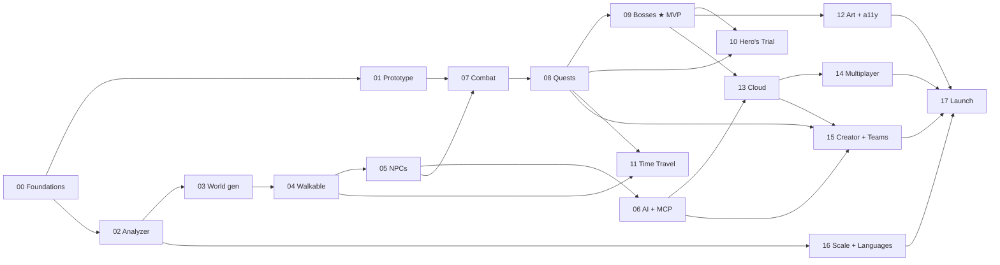

# Codebase Quest: Plans

> **"Every codebase is a world. Go explore."**
> An open-source 2D pixel-art RPG generated from any code repository. Folders are
> regions, files are buildings, functions are characters, and code smells are
> monsters **whose bodies are made of their real code**. Hotspots are bosses, and
> the final quest is a real issue. No API key needed: your own AI agent can power
> it through MCP.

## What's in this folder

| Path | What it is |
|---|---|
| [MASTER-PLAN.md](MASTER-PLAN.md) | The big connected plan: vision, world mapping, **Code-Body Combat**, bestiary, bosses, items, progression, AI modes + MCP, architecture, testing, roadmap, art pipeline, open source and community |
| [`phases/`](phases/) | **18 sub-plans** (P00–P17), built and tested one at a time |
| [`templates/AGENTS.md`](templates/AGENTS.md) | Rules for AI agents working on the repo; copy to the repo root |
| [`templates/CLAUDE.md`](templates/CLAUDE.md) | One line that imports `AGENTS.md` for Claude Code; copy to the repo root |

## Getting started (one-time)

1. Create a **public** GitHub repo (e.g. `codebase-quest`) and clone it on your laptop.
2. Copy this whole folder into the repo as **`docs/plans/`**.
3. Copy `docs/plans/templates/AGENTS.md` and `docs/plans/templates/CLAUDE.md` to the **repo root**.
4. Open Claude Code in the repo folder and paste the **start prompt** from
   [P00](phases/P00-foundations-open-source.md#start-prompt-for-claude).

## How every phase works

1. Give Claude the phase's **start prompt** (at the bottom of every phase file).
2. Claude works on a branch `phase/XX-<slug>`, implements the scope, runs the
   automated tests, and fills in **Results**.
3. **You** run the phase's **manual test script** and check the **Definition of done**.
4. Merge the branch (CI must be green), update the status table below, and move on.
5. If anything deviates from the plan, it's recorded as an ADR in `docs/adr/`.

Generic start prompt (each phase file has its own version):
```
Read AGENTS.md, docs/plans/README.md, the MASTER-PLAN sections listed in the
phase header, and docs/plans/phases/PXX-<name>.md. Implement Phase XX on branch
phase/XX-<slug>. Run the automated tests, walk me through the manual test
script, and fill in the Results section. Ask before pushing.
```

## Build order and status

| # | Phase | Milestone | Effort | Status |
|---|---|---|---|---|
| 00 | [Foundations and Open-Source Setup](phases/P00-foundations-open-source.md) | A · Prove the Fun | 3–5 days | ⬜ Not started |
| 01 | [Prototype: Fun and Look](phases/P01-prototype-fun-and-look.md) | A · Prove the Fun | ~1 week | ⬜ Not started |
| 02 | [Code Analyzer](phases/P02-analyzer.md) | B · The Map | 1.5–2.5 wks | ⬜ Not started |
| 03 | [World Generator](phases/P03-world-generator.md) | B · The Map | 1.5–2 wks | ⬜ Not started |
| 04 | [Walkable World](phases/P04-walkable-world.md) | B · The Map | 1–1.5 wks | ⬜ Not started |
| 05 | [NPCs, Code Panel and Codex](phases/P05-npcs-code-codex.md) | C · The People | 1–1.5 wks | ⬜ Not started |
| 06 | [AI Content Engine, MCP Server and Gitling](phases/P06-ai-mcp-gitling.md) | C · The People | 2–2.5 wks | ⬜ Not started |
| 07 | [Code-Body Combat and Question Library](phases/P07-code-body-combat.md) | D · The Game | 2.5–3 wks | ⬜ Not started |
| 08 | [Quests, Progression and Saves](phases/P08-quests-progression.md) | D · The Game | 2–2.5 wks | ⬜ Not started |
| 09 | [Bosses and Dungeons ★ MVP](phases/P09-bosses-dungeons.md) | D · The Game | 2–3 wks | ⬜ Not started |
| 10 | [Hero's Trial](phases/P10-heros-trial.md) | E · Real Heroes | 1.5–2 wks | ⬜ Not started |
| 11 | [Time Travel, Chronicles and Heralds](phases/P11-time-travel.md) | E · Real Heroes | 2 wks | ⬜ Not started |
| 12 | [Art, Audio, Polish and Accessibility](phases/P12-art-audio-accessibility.md) | F · Beautiful World | 2–3 wks | ⬜ Not started |
| 13 | [Accounts, Cloud and Sharing](phases/P13-cloud-sharing.md) | G · Together | 2–3 wks | ⬜ Not started |
| 14 | [Multiplayer: Guide and Raids](phases/P14-multiplayer.md) | G · Together | 2–3 wks | ⬜ Not started |
| 15 | [Creator Mode and Team Tools](phases/P15-creator-team-tools.md) | G · Together | 2.5–3 wks | ⬜ Not started |
| 16 | [Scale and More Languages](phases/P16-scale-languages.md) | H · Everywhere | 3–5 wks | ⬜ Not started |
| 17 | [Launch and Community](phases/P17-launch-community.md) | H · Everywhere | ~2 wks + ongoing | ⬜ Not started |

Status legend: ⬜ Not started · 🟨 In progress · ✅ Done · ⏸️ Paused

**MVP = Phases 00–09 (≈ 4–5 months for one person with an AI assistant).**
Phase 02 can start right after Phase 00, in parallel with the Phase 01 prototype.

## How the phases connect



## What each milestone lets you show

| Milestone | Demo |
|---|---|
| **A · Prove the Fun** (00–01) | "The combat idea is fun and the art style works." |
| **B · The Map** (02–04) | "My repo as a world I can walk around." ← good moment for the first public devlog |
| **C · The People** (05–06) | "Functions talk to me; my agent prepared the world with no API key." |
| **D · The Game** (07–09) ★ | "Monsters made of real code, quests, bosses, a final boss." |
| **E · Real Heroes** (10–11) | "Playing ends in real contributions; history is playable." |
| **F · Beautiful World** (12) | "It looks, sounds and feels polished and accessible." |
| **G · Together** (13–15) | "Share any public repo, mentor others, author official worlds." |
| **H · Everywhere** (16–17) | "Most languages, huge repos, launched, with a community." |

## Every phase file has the same sections

Header (milestone · depends on · effort · **read first**) · Goal · Why now · Scope
(in / out) · Design · Tasks · Automated tests · Manual test script · Definition of
done · Risks · Hand-off · **Start prompt for Claude** · Results.

## The 8 design pillars (check every decision against these)

1. Every mechanic teaches something real.
2. Ground truth over guesswork: AI never decides a scored answer.
3. Your code, your world: deterministic and recognizable.
4. Fun first, never homework; prove the fun with a prototype.
5. Private and keyless by default: no API key needed; agent mode via MCP.
6. Respect the humans: opt-outs, consent, project rules.
7. Honest about uncertainty.
8. Open and welcoming.
