# Phase 02: Code Analyzer

> **Milestone:** B · The Map · **Depends on:** 00 · **Effort:** 1.5–2.5 weeks ·
> **Status:** Implemented and tested on `phase/02-analyzer`; owner's manual project review pending
> **Read first:** MASTER-PLAN §2 (pillars 2, 3, 7), §8, §16.4, §16.5, §16.8, §17

## Goal
`cq analyze <path>` turns a TypeScript/JavaScript or Python repository into a
**CodeGraph JSON**: files, symbols, imports, calls, metrics, git stats, smells,
entry points, test facts and diagnostics. The output is deterministic, honest
about uncertainty, and fast enough for real projects.

## Why now
Everything in the game comes from these facts. If the facts are wrong, the world,
puzzles and AI are wrong. This is the foundation of Pillar 2 (ground truth).

## Scope

### In
- Languages: **TypeScript, TSX, JavaScript, JSX, Python**.
- File discovery, role classification, parsing, symbols, imports, calls (with
  confidence), metrics, git stats, smells v1, entry points, test linkage, test
  facts (literal assertions), docs extraction and diagnostics.
- CLI: `cq analyze`, `cq stats`.
- The full zod schema for CodeGraph v1 in `packages/shared`.

### Out (later phases)
- Other languages (Phase 16).
- Exact type-checker-based resolution (Phase 16). This phase uses
  syntax-tree-based resolution with confidence levels.
- Git history across commits (Phase 11). This phase reads stats only.
- Running any repository code (never in this phase).

## Design

### Pipeline

```mermaid
flowchart LR
    D["1 Discover files"] --> C["2 Classify roles"]
    C --> P["3 Parse (tree-sitter)"]
    P --> S["4 Extract symbols"]
    S --> I["5 Resolve imports"]
    I --> K["6 Extract calls"]
    K --> M["7 Metrics"]
    M --> G["8 Git stats"]
    G --> T["9 Tests and test facts"]
    T --> E["10 Entry points"]
    E --> X["11 Smells"]
    X --> O["12 Sort, ID, validate, write"]
```


### 1. Discover files
- Respect `.gitignore` (use git's own listing when the folder is a git repo:
  `git ls-files`, plus untracked but not ignored files).
- Always skip: `node_modules`, `vendor`, `dist`, `build`, `.venv`, `__pycache__`,
  binary files (null-byte sniffing), files > 1 MB (record a diagnostic), symlinks
  (record, don't follow).
- **Never read** `.env*`, `*.pem`, `*.key`, `id_rsa*`, or credential files. Record
  them as `secret-skipped` diagnostics without content.

### 2. Classify file roles
`source | test | config | docs | build | ci | manifest | migration | generated | asset`

Use path and name rules (e.g. `tests/`, `*.test.ts`, `test_*.py` → test;
`.github/workflows` → ci; `package.json`, `pyproject.toml` → manifest; a
"generated" header comment → generated). Rules live in one table so they're
easy to extend.

### 3. Parse
- `web-tree-sitter` with WASM grammars for TypeScript, TSX, JavaScript and Python.
- Parse in a **worker pool** (Node `worker_threads`), sized to CPU count minus 1.
- Syntax errors don't stop analysis: tree-sitter recovers. Record a diagnostic
  with the location.

### 4. Extract symbols
| Kind | TS/JS | Python |
|---|---|---|
| function | function declarations; `const x = () => {}` / `function` expressions bound to names | `def` at module level |
| class | `class` | `class` |
| method | class methods, getters, setters, constructors | `def` inside a class |
| interface / type | `interface`, `type` aliases | — (annotations only) |

Per symbol: name, qualified name (`Class.method`), range (lines), exported?,
async?, generator?, parameters (names, annotated types if present), doc comment
(JSDoc / docstring) and decorators.

**Traits** (used later for NPC looks): `exported`, `async`, `constructor`,
`event-handler` (names like `on*` / `handle*`, or registered via `.on(`),
`recursive` (calls itself), `does-io` (calls known I/O APIs: `fs.*`, `fetch`,
`open(`, `requests.*`, database clients, from a configurable list), `pure-candidate`
(no I/O, no writes to outer variables detected), `deprecated` (`@deprecated` tag or
decorator) and `test` (inside a test file).

### 5. Resolve imports
- Relative imports → file IDs (try extensions `.ts .tsx .js .jsx .mjs .cjs`,
  `index.*`, and Python packages with `__init__.py`).
- Bare imports (`react`, `requests`) → **external dependency** nodes (for the
  Foreign Lands), matched against the manifest.
- `tsconfig.json` `paths` aliases: basic support (read `compilerOptions.paths`).
- Unresolved imports → diagnostic + an edge with `confidence: "guess"` or none.

### 6. Extract calls (with confidence)
For each call expression inside a symbol:
1. Callee is a local function in the same file → `exact`.
2. Callee is an imported named binding that resolves to a symbol → `exact`.
3. `this.method()` / `self.method()` inside a class with that method → `exact`.
4. `obj.method()` where `obj` is a module namespace import → `likely`.
5. A unique name match elsewhere in the repo → `guess`.
6. Dynamic (`obj[name]()`, `getattr`, callbacks passed around) → no edge; count
   in the symbol's `dynamicCalls` metric.

> Only `exact` edges are used for **scored** puzzles (Phase 07). `likely` and
> `guess` edges can appear in the world as flickering roads.

### 7. Metrics
Per symbol: `loc`, `cyclomatic` (1 + branch nodes: `if`, `else if`, `case`,
loops, `catch`, `&&`, `||`, `?:`, comprehension conditions), `maxNesting`,
`params`, `fanIn`, `fanOut` and `dynamicCalls`. Per file: `loc`, symbol count and
the smells count (filled in later).

### 8. Git stats (current snapshot only)
Using the git CLI (`git log --numstat --format=...` once, parsed): per file,
`firstCommitAt`, `lastCommitAt`, `commits` and `churn` (lines added + deleted),
plus the number of distinct authors. **Author names are not stored in this
phase** (Phase 11 handles them with opt-outs). For non-git folders the stats are
`null`, with a diagnostic.

### 9. Tests and test facts
- **Test linkage:** symbols imported or called inside test files create
  `tests` edges (test function → symbol).
- **Test facts:** extract simple literal assertions. They power **Pierce Heart**
  and monster turns in Code-Body Combat (Phase 07), with no code execution needed.
  - JS/TS: `expect(fn(<literals>)).toBe(<literal>)` / `.toEqual(<literal>)` /
    `assert.equal(fn(...), ...)`.
  - Python: `assert fn(<literals>) == <literal>`, `self.assertEqual(fn(...), ...)`.
  - Only literals (numbers, strings, booleans, null/None, simple arrays and
    objects). Anything else → skipped.

```ts
interface TestAssertion {
  id: string; testFileId: string; line: number;
  calleeSymbolId: string;
  args: LiteralValue[]; expected: LiteralValue;
  matcher: "equal" | "deep-equal";
}
```

### 10. Entry points
- `package.json` `main` / `bin` / `exports`; `if __name__ == "__main__":`.
- HTTP routes: Express-style `app.get/post/...("/path", handler)`, `router.*`;
  Flask/FastAPI decorators `@app.route`, `@app.get`, `@router.post`. Store the
  method and path as the label.
- CLI commands: `commander` `.command(...)`, `argparse` subparsers, `click` /
  `typer` decorators (basic).
- Event handlers registered with `.on("event", fn)`.

### 11. Smells v1
Implement detection for every Bestiary row in Master Plan §8 using the default
thresholds (configurable in `codequest.config.json`). Every smell stores
**evidence** (lines, measured value, threshold) so the game can explain itself.

- **Mimic:** hash normalized syntax-tree subtrees (identifiers renamed to
  placeholders) of at least 6 statements; group equal hashes.
- **Ghost vs Wisp:** no incoming edges, not exported, not an entry point, not a
  test. Call it a **Wisp** if the file has dynamic calls or the name is used as a
  string anywhere (possible reflection), otherwise a **Ghost**.
- **Ouroboros:** strongly connected components in the file import graph (Tarjan's
  algorithm).

### 12. IDs, sorting, validation, output
- ID = first 12 hex characters of `sha1(path + "#" + kind + "#" + qualifiedName + "#" + ordinal)`.
- Sort every array by ID; serialize keys in schema order.
- Validate with the zod schema before writing. Invalid → crash loudly (a bug, not
  user error).
- `diagnostics[]` collects every skip, parse error and unresolved import. **Nothing
  is silently dropped.**

### CLI
```
cq analyze <path> [--out graph.json] [--pretty] [--config codequest.config.json]
cq stats <graph.json>     # summary: files, symbols, edges by confidence, smells by kind, diagnostics
```

## Tasks
- [x] Define the CodeGraph v1 zod schema in `packages/shared` (all types above).
- [x] File discovery + secret skip list + role classification (table-driven).
- [x] Tree-sitter setup (WASM grammars bundled in `packages/analyzer/grammars`) + worker pool.
- [x] Symbol extractors: TS/JS, then Python (shared interface `LanguageExtractor`).
- [x] Traits detection.
- [x] Import resolution (TS/JS, Python, tsconfig paths).
- [x] Call extraction with the confidence rules.
- [x] Metrics (cyclomatic, nesting, LOC, fan-in/out).
- [x] Git stats via the git CLI.
- [x] Test linkage + test facts extraction.
- [x] Entry points.
- [x] Smells v1 (all static Bestiary kinds; Mutant reserved for injected mutations) + config thresholds.
- [x] IDs, sorting, validation, writer.
- [x] CLI commands `analyze` and `stats`.
- [x] Docs: `packages/analyzer/README.md` explaining every rule and its confidence.

## Automated tests
- **Extractor unit tests:** small code snippets per language, e.g. an arrow
  function bound to a const gives one function symbol with the right range.
- **Golden snapshots:** `tiny-ts`, `tiny-py`, `smelly-ts` → committed
  `*.graph.json`. Any change shows up as a reviewable diff.
- **Answer-key tests:** every smell in `smelly-ts/SMELLS.md` is detected with the
  right kind and location; no unexpected smells of those kinds.
- **Known facts in `tiny-ts`:** the chain `shareTask → checkPermissions →
  loadTeam → query` exists with `exact` edges; `computeTaskStatus` has the
  highest cyclomatic complexity; `formatDate` is a Mimic pair; the circular
  import is one Ouroboros; at least 3 test facts are extracted for `slugify`.
- **Invariants (all fixtures):** every edge's `from`/`to` exists; no duplicate
  IDs; all ranges inside their files; schema-valid.
- **Determinism:** analyze twice → byte-identical output.
- **Robustness:** `weird-repo` completes with diagnostics for each oddity, and
  the `.env` secret value **does not appear anywhere** in the output (search
  test).
- **`empty-repo`:** a valid, empty graph.
- **Real-repo smoke (nightly):** pinned repos analyze without crashing; sanity
  thresholds (e.g. > 50% of internal imports resolved; < 5% files with parse
  errors).
- **Performance:** benchmark on the largest pinned repo; record time and peak
  memory; fail if more than 2× the baseline.

## Manual test script
1. `pnpm cq -- analyze fixtures/repos/tiny-ts --pretty --out out/tiny.json`.
2. `pnpm cq -- stats out/tiny.json`. Check that the counts look right against what you know about Taskly.
3. Open `out/tiny.json` and find `computeTaskStatus`. Check its metrics and edges by reading the source yourself.
4. Run it on **one of your own real projects**. Look at `stats`, and pick 3 functions you know well. Are their callers and callees right?
5. Run it on `weird-repo`. Read the diagnostics; each oddity is reported clearly.

## Definition of done
- [x] All automated tests green, including determinism and the secret-skip test (known grammar recovery deviation below).
- [x] `tiny-ts` and `tiny-py` known facts all pass.
- [x] Analyzer README documents every rule.
- [ ] Your own real project analyzes successfully, and your spot-check of 3 functions is correct (or the gaps are recorded as diagnostics).

## Risks
| Risk | Mitigation |
|---|---|
| Call resolution is wrong in tricky code | Confidence levels; only `exact` used for scoring; spot-check real repos |
| Tree-sitter grammar differences across versions | Pin grammar versions; golden tests catch changes |
| Slow on big repos | Worker pool, skip rules, benchmark gate; deeper work in Phase 16 |
| Thresholds feel arbitrary | Configurable; revisit after playtests |

## Hand-off to the next phase
Phase 03 receives a validated, deterministic CodeGraph with roles, metrics,
edges with confidence, smells, entry points and test facts.

## Start prompt for Claude
```
Read AGENTS.md, docs/plans/README.md, the MASTER-PLAN sections listed in the
phase header, and docs/plans/phases/P02-analyzer.md.
Implement Phase 02 on branch phase/02-analyzer. Run the automated tests,
walk me through the manual test script, and fill in the Results section.
```

## Results (fill in after testing)
- Date: 2026-10-19; Windows, Node 24.20.0, pnpm 10.33.1.
- Automated tests actually run:
  - `pnpm test`: **162/162 passed in 27 files**. Includes syntax extraction for
    TS/TSX/JS/JSX/Python, literal-only facts, call confidence, shadowing, aliases,
    namespace/reexport/package resolution, this/self methods, grammar hashes,
    credential paths never read (instrumented), ignored/non-git folders, hostile
    code never executed, CLI commands, all six fixture invariants/determinism,
    and three committed graph goldens. Existing Phase 00/01 tests remain green.
  - Smelly fixture audit: **14 static findings**, exactly matching the answer
    key's kinds, files, symbols and ranges; no unexpected findings. The 15th row,
    Mutant, explicitly describes a future injected mutation and is not emitted.
  - Taskly: exact shareTask → checkPermissions → loadTeam → query chain;
    computeTaskStatus cyclomatic 5 (highest), archiveCompleted nesting 4;
    one formatDate Mimic pair and one import cycle; 11 literal facts in tiny-ts
    including four slugify and four status assertions; eight facts in tiny-py.
  - Weird repo: binary, symlink, oversized file, invalid UTF-8, empty file,
    CRLF, deep path, syntax recovery and secret-skipped diagnostics. Secret
    values absent from serialized output. Empty repo produces a valid empty graph.
  - `pnpm e2e` with `CQ_E2E_PORT=4181`: **14/14 passed** (regression suite).
  - `pnpm check`, `pnpm build`, `pnpm license-check -- --enforce`,
    `git diff --check`: passed. Biome excludes canonical golden JSON to preserve
    the analyzer's exact serializer bytes. Grammar binaries have MIT entries,
    upstream license copies, SHA-256 hashes and Git LFS attributes.
  - `pnpm analyzer:smoke --update-baseline` and `pnpm analyzer:smoke`: ran on
    all four already-fetched pinned commits without executing their code.
    Internal import resolution: Zustand 92.68%, Jotai 99.17%, Flask 100%,
    Requests 100%. Three repos have zero parser-error files. Zustand has five
    known grammar recovery files (10% raw rate), retained in diagnostics and
    explicitly allowlisted by commit/path; affected call edges are downgraded,
    and those files cannot produce scored facts. No new parser-error files.
  - Largest pinned repo benchmark: **Jotai, 19,249 recorded source lines**;
    baseline **936 ms, 518 MiB peak process RSS**. Independent regression run
    **1,015 ms, 506 MiB**, within the enforced 2× time/RSS bounds. Worker memory
    is included in process RSS. Nightly smoke/performance workflow added locally.
  - **Not run:** remote GitHub CI/nightly. Nothing pushed; no PR or settings change.
- Real project tried + spot-check notes:
  - `pnpm cq -- analyze . --pretty --out out/codebase-quest.graph.json` and
    `pnpm cq -- stats out/codebase-quest.graph.json` completed on this project.
  - Agent checked three existing combat functions against their source:
    `checkAction` resolves info/cs/isActive/isExposed/questionFor and its local
    no helper; `act` resolves checkAction/draft/info/cs/twinsOfRow/questionFor;
    `endTurn` resolves draft/cs/allInputs/finishMonsterTurn. These edges are exact.
    Unknown receiver methods are diagnostic gaps, not fabricated exact targets.
  - The owner still needs to choose/confirm their own three familiar functions;
    this is not recorded as an owner-run manual test.
- Manual walkthrough: follow steps 1–5 above. Open `out/tiny.json`, locate
  computeTaskStatus and verify complexity 5 and the chain. Repeat analyze/stats
  on your own selected project; compare three familiar functions with source.
  Finally analyze weird-repo and read each diagnostic. Full rule/command details:
  [`packages/analyzer/README.md`](../../../packages/analyzer/README.md).
- Decisions / ADRs:
  - [ADR 0005](../../adr/0005-analyzer-contract-and-confidence.md): full v1
    contract, memory cap of eight workers, static Mutant exclusion, normalized
    near-copy detection, and honest known-grammar recovery/threshold deviation.
  - Phase 03 was explicitly queued by the owner while this work was running;
    its implementation begins only after this analyzer implementation and tests.
