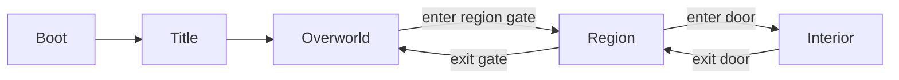

# Phase 04: Walkable World

> **Milestone:** B · The Map · **Depends on:** 03 · **Effort:** 1–1.5 weeks ·
> **Status:** Not started
> **Read first:** MASTER-PLAN §5, §5.7, §16.9

## Goal
`cq play <repo>` analyzes the repo, generates the world, and opens the game in
the browser. You can walk the overworld, enter regions and go inside buildings,
with a minimap, labels, fog of war and a "where am I in the code" breadcrumb.
**Milestone B demo: "Here's my repo as a world I can walk around."**

## Why now
This is the first moment the idea becomes *real* and visible, and the first
chance to feel whether it's fun to walk through your own code.

## Scope

### In
- Phaser scenes: Boot/Preload, Title, Overworld, Region, Interior, plus a HUD
  overlay.
- World loading from `world.json` + Tiled maps (served locally by the CLI).
- Player movement (keyboard, gamepad, click-to-move), collisions, camera, zoom.
- Transitions: overworld ↔ region ↔ interior through doors and gates.
- Labels: region names, building signs (file names), street names (folders).
- Minimap and a full-screen map (M key).
- Fog of war (seen / unseen tiles), saved in memory for the session.
- Breadcrumb HUD, e.g. `taskly / src / services / taskService.ts`.
- Debug overlay (F3) and `window.__CQ__` extensions.
- `cq play` command.

### Out (later phases)
- Talking to NPCs (Phase 05): NPCs appear as **static placeholder markers** here.
- Monsters moving and fighting (Phase 07): static markers here.
- Saving progress across sessions (Phase 08).
- Final art (Phase 12).

## Design

### `cq play <repo-path>`
1. Run analyze → generate into `<repo>/.codequest/cache/<commit>/` (or a temp
   folder for read-only repos), reusing the cache if the commit hasn't changed.
2. Start a small local static server (Vite preview or a tiny Node server) that
   serves the built game plus `/world/*` from the cache folder.
3. Open the browser at `http://localhost:<port>/?world=/world/world.json`.
4. Print a clear summary: regions, buildings, NPCs, monsters, time taken.

The game can also load fixtures directly: `?world=fixtures/tiny-ts` (dev only),
which is what tests use.

### Scenes and flow

- One **active map scene** at a time plus a persistent **HUD scene**.
- Transitions: a short fade, the player placed at the matching door or gate.

### Movement and controls
| Input | Action |
|---|---|
| Arrows / WASD | Move (8-direction, normalized diagonal speed) |
| Shift | Run |
| Mouse click | Click-to-move (A\* on the collision grid) |
| Gamepad left stick | Move |
| E / Space / Enter | Interact (doors now; NPCs in Phase 05) |
| M | Full map |
| F3 | Debug overlay |
| Esc | Pause menu (settings stub) |

All bindings live in one config (remapping UI comes in Phase 12).

### Camera and map display
- Camera follows the player with a deadzone; scroll-wheel zoom between 3 levels.
- **Large maps:** Phaser tilemap layers with culling; split regions bigger than
  200×200 tiles into chunks loaded on demand.

### Labels
- Region names float above region areas on the overworld.
- Building signs appear when the player is within 4 tiles (file name; full path
  on hover).
- Street names (folder names) at intersections.
- Font: a readable pixel font with a **fallback non-pixel font option** (for
  accessibility, wired up in Phase 12).

### Fog of war
- A fog layer above the map. Tiles within a reveal radius (8 tiles) become
  *seen*.
- Each fully-seen building's file moves to the `seen` comprehension state
  (in-memory here; persisted in Phase 08).

### Minimap and map
- Minimap (top-right): a downscaled render of the current map with a player dot,
  gates and seen areas only.
- Full map (M): overworld with region names and the "you are here" marker.

### HUD breadcrumb
Shows the code location of the player's current position:
`kingdom / region path / district path / file (when inside a building)`.

### Debug API additions (`window.__CQ__`)
```ts
getWorldSummary(): { regions: number; buildings: number; npcs: number };
getLocation(): { scene: string; regionId?: string; buildingId?: string; breadcrumb: string };
enterBuilding(buildingId: string): Promise<void>;
gotoRegion(regionId: string): Promise<void>;
getFogSeenRatio(): number;
```

## Tasks
- [ ] World loader (fetch `world.json` + maps; validate with zod; theme → tileset mapping).
- [ ] Boot/Preload/Title scenes (title shows the kingdom name).
- [ ] Overworld, Region and Interior scenes with transitions.
- [ ] Player controller (keyboard, gamepad, click-to-move with A\*).
- [ ] Camera, zoom, chunked loading for large maps.
- [ ] Labels: regions, building signs, streets.
- [ ] Fog of war + seen tracking.
- [ ] Minimap + full map.
- [ ] HUD breadcrumb.
- [ ] Static placeholder markers for NPCs, monsters, bosses, portals and landmarks.
- [ ] Debug overlay (FPS, tile coords, entity IDs under cursor) + debug API additions.
- [ ] `cq play` (analyze → generate → cache → serve → open browser).

## Automated tests
- **Unit:** world loader validates good worlds and rejects broken ones with
  clear errors; theme mapping covers every abstract tile.
- **E2E (Playwright, `tiny-ts` fixture):**
  - The game loads; the title shows "Kingdom of Taskly"; continue → Overworld.
  - `gotoRegion(<Port of API>)` → the scene is Region and the breadcrumb contains `src/api`.
  - Walk to a building door (teleport near it, then press the interact key) → Interior scene; the breadcrumb ends with the file name.
  - Exit → back in Region at the same door.
  - Walk 20 tiles → `getFogSeenRatio()` increased.
  - Click-to-move: click a reachable tile → the player arrives within N seconds.
- **Visual regression:** screenshots of the Overworld, one Region and one Interior
  (tolerance threshold).
- **Performance (headless, rough):** a stress world with 2,000 buildings keeps the
  average frame time under a threshold; record the value.
- **CLI:** `cq play fixtures/repos/tiny-ts --no-open` starts, serves `world.json`
  (HTTP 200) and uses the cache on the second run (faster, logged).

## Manual test script
1. `pnpm cq -- play fixtures/repos/tiny-ts`; the browser opens.
2. Walk around the overworld. Can you tell which region is which?
3. Enter the Port of API. Find the building for `routes.ts`, go inside, and read the breadcrumb.
4. Press M. Is the map readable? Press F3. Do the numbers update?
5. Try only the mouse (click-to-move), then a gamepad if you have one.
6. Run `cq play` on **your own project**. Walk for 5 minutes. Write down 3 things that feel good and 3 that feel confusing. This is your first mini playtest.

## Definition of done
- [ ] All tests green.
- [ ] `cq play` works on fixtures and on your own project.
- [ ] Movement feels smooth (no stutter; 60 fps on your machine with a mid-size repo).
- [ ] Mini playtest notes recorded below.

## Risks
| Risk | Mitigation |
|---|---|
| Walking is boring | Keep regions compact; add run; Phase 05 adds characters fast |
| Labels clutter the screen | Proximity-based signs; zoom-level rules |
| Large maps stutter | Chunking, culling, profiling with the debug overlay |

## Hand-off to the next phase
Phase 05 receives a walkable world with NPC spots already rendered as
placeholders and an interact key ready to wire up.

## Start prompt for Claude
```
Read AGENTS.md, docs/plans/README.md, the MASTER-PLAN sections listed in the
phase header, and docs/plans/phases/P04-walkable-world.md.
Implement Phase 04 on branch phase/04-walkable-world. Run the automated tests,
walk me through the manual test script, and fill in the Results section.
```

## Results (fill in after testing)
- Date:
- Automated tests:
- Mini playtest notes (3 good / 3 confusing):
- Decisions / ADRs:
