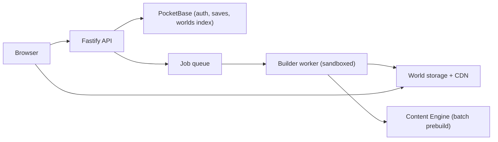

# Phase 13: Accounts, Cloud and Sharing

> **Milestone:** G · Together · **Depends on:** 06, 09 · **Effort:** 2–3 weeks ·
> **Status:** Not started
> **Read first:** MASTER-PLAN §16.6, §19, §22

## Goal
Anyone can play **any public GitHub repo** from a link like
`codebasequest.app/play/github/<owner>/<repo>`. Maintainers can add a **"▶ Play
this repo"** badge to their README. Players can create accounts, sync saves
across devices, appear on opt-in leaderboards (daily challenge, speedrun), and
browse a **gallery** of featured kingdoms. Private code stays local.

## Why now
Sharing is the growth engine, and it needs the polished MVP (Phases 09 and 12)
and the content engine's caching (Phase 06) to keep costs under control.

## Scope

### In
- `apps/server`: Fastify API + **PocketBase** (auth, records, files).
- The public-world pipeline: clone → analyze → generate → precompute content →
  store per commit → serve.
- Play URLs, the badge generator and the gallery.
- Accounts (email or GitHub sign-in through PocketBase OAuth), cloud saves with
  sync and conflict handling.
- Leaderboards (opt-in): daily challenge, speedrun.
- A shared content cache for public worlds (server-side).
- Rate limits, quotas, abuse protection and cost controls.
- Privacy policy and terms pages (drafts for a human review).

### Out (later phases)
- Multiplayer (Phase 14).
- Team and enterprise features (Phase 15).
- Payments (Phase 17).
- Uploading private repos (not planned; private stays local, with a self-hosted
  team option in Phase 15).

## Design

### Architecture


### The public-world pipeline
1. Request: `GET /play/github/:owner/:repo[?ref=]` → look up the default branch and
   current commit through the GitHub API.
2. If a world for `(repo, commit)` exists → serve it. Otherwise enqueue a build and
   show a "Building your kingdom…" screen with progress.
3. **Builder worker** (sandboxed container, no secrets mounted, network only to
   GitHub): shallow clone → `cq analyze` → `cq generate` → `cq content prebuild`
   (Batches API) → upload the world bundle to storage.
4. **Limits:** repo size ≤ 200 MB, ≤ 1M lines (Phase 16 raises this), build time
   ≤ 10 minutes; otherwise a friendly message.
5. **Caching:** the world bundle is immutable per commit and served through a CDN.
   Rebuilds are triggered by new commits at most once per hour per repo.
6. **Licensing:** only analyze public repos; show the repo's license and link to
   the source; code snippets are shown with attribution and a link.

### Badge
A generator page outputs markdown:
`[](…/play/github/owner/repo)`. Badge variants:
light, dark and a "kingdom light %" community stat (optional).

### Accounts and saves
- PocketBase auth: email + password or GitHub OAuth (GitHub sign-in also enables
  Contributor Cape verification).
- **Cloud saves:** same `SaveVn` schema; sync on load, autosave and quit;
  conflicts → keep both, ask the player which to use (show timestamps and
  progress).
- Local-only play stays fully supported (no account needed).

### Leaderboards (opt-in)
- Daily challenge: score = correct answers × speed bonus; one attempt counts per
  day.
- Speedrun: per repo and commit, seeded tasks ("find X"), validated server-side
  (the server re-checks the answers; the client only reports choices and times).
- A display name only; no real names required.

### Gallery
Featured kingdoms of popular open-source projects (curated), recently built
worlds (opt-out by maintainers through `.codequest/world.yml` `listed: false`),
and filters by language and size.

### Cost and abuse controls
- Per-IP and per-account build quotas; a global daily AI budget for public prebuilds.
- The shared content cache means each repo/commit is generated once for everyone.
- Bot protection on build requests (rate limits + proof-of-work or a privacy-friendly
  challenge), with **no** heavy tracking.
- Monitoring: build queue length, failures, AI spend, storage.

## Tasks
- [ ] `apps/server` scaffold (Fastify) + PocketBase setup (collections: users, saves, worlds, builds, leaderboards).
- [ ] Job queue + sandboxed builder worker (container image, limits).
- [ ] Play route + building screen + world bundle loading from the CDN.
- [ ] Badge generator page.
- [ ] Accounts (email, GitHub OAuth) + cloud saves + conflict UI.
- [ ] Leaderboards with server-side validation.
- [ ] Gallery + maintainer opt-out.
- [ ] Shared content cache.
- [ ] Rate limits, quotas, monitoring dashboard.
- [ ] Privacy policy and terms drafts (marked for human or legal review).

## Automated tests
- **API:** auth flows, save sync, conflict cases, leaderboard validation (a forged score is rejected).
- **Pipeline integration:** build worlds for fixture repos served from a local git server; the build result equals the local `cq` output for the same commit.
- **Security:** the builder container has no secrets in its environment; path traversal attempts are rejected; oversized repos are rejected cleanly; network egress is limited to GitHub (test).
- **Load (basic):** 100 concurrent players on a cached world (CDN-like serving) under a latency threshold.
- **E2E:** open a play URL → building → play → sign up → save → open on a second browser profile → progress synced.

## Manual test script
1. Deploy to a staging server (or run locally with Docker Compose).
2. Open `/play/github/<a small public repo you like>`. Watch it build and play it.
3. Create an account, play, then open in another browser; progress is there.
4. Add the badge to a test README and click it.
5. Play the daily challenge and check the leaderboard.

## Definition of done
- [ ] All tests green, including the security tests.
- [ ] Building and playing a public repo end-to-end works on staging.
- [ ] Cost per new public world recorded (AI + compute).
- [ ] The privacy and terms drafts exist and are flagged for review.

## Risks
| Risk | Mitigation |
|---|---|
| Costs spike from many builds | Quotas, shared cache, budgets, CDN |
| Malicious repos | Sandboxed builder; code never executed; size and time limits |
| Maintainers object | Opt-out listing, attribution, official worlds (Phase 15) |

## Hand-off to the next phase
Phase 14 receives accounts and server infrastructure; Phase 15 receives worlds and
sync for team features.

## Start prompt for Claude
```
Read AGENTS.md, docs/plans/README.md, the MASTER-PLAN sections listed in the
phase header, and docs/plans/phases/P13-cloud-sharing.md.
Implement Phase 13 on branch phase/13-cloud-sharing. Run the automated tests,
walk me through the manual test script, and fill in the Results section.
```

## Results (fill in after testing)
- Date:
- Automated tests:
- Cost per public world:
- Decisions / ADRs:
